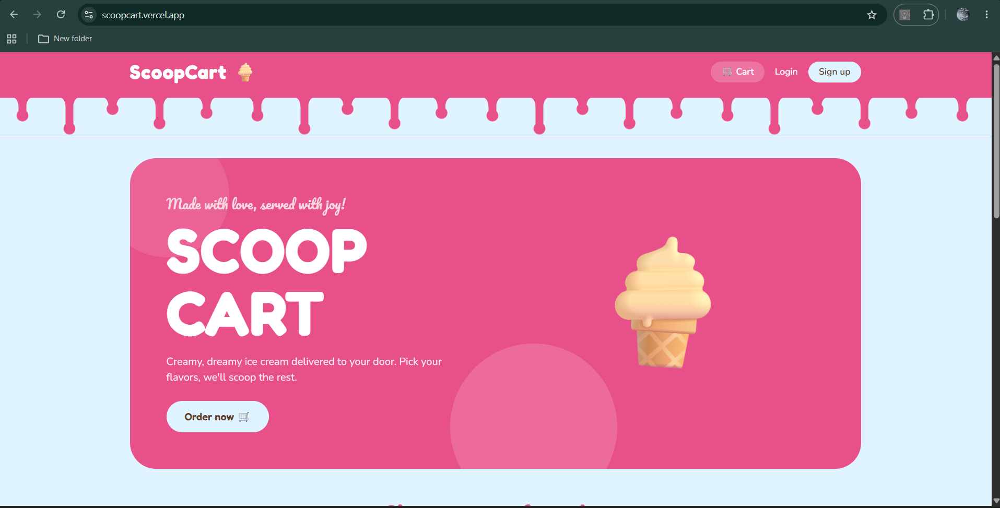
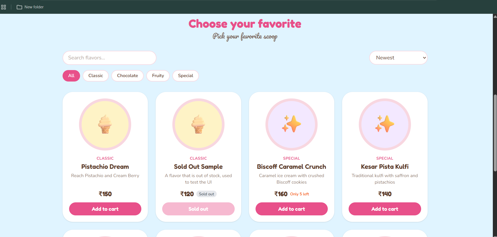
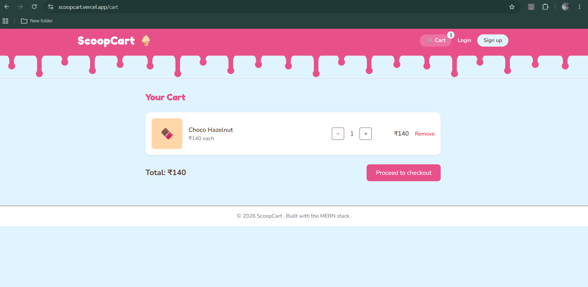
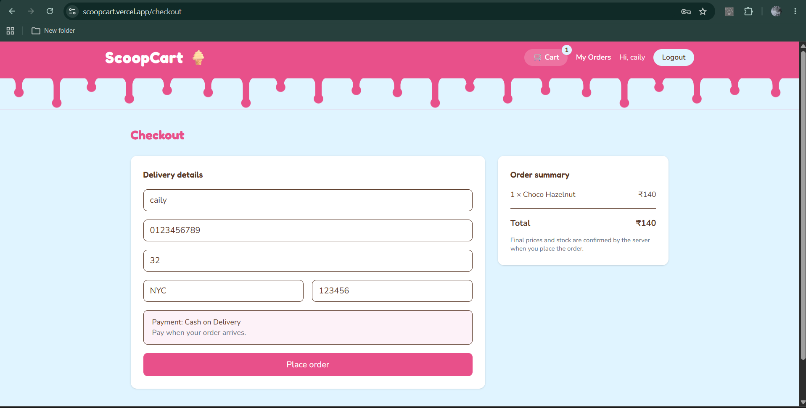
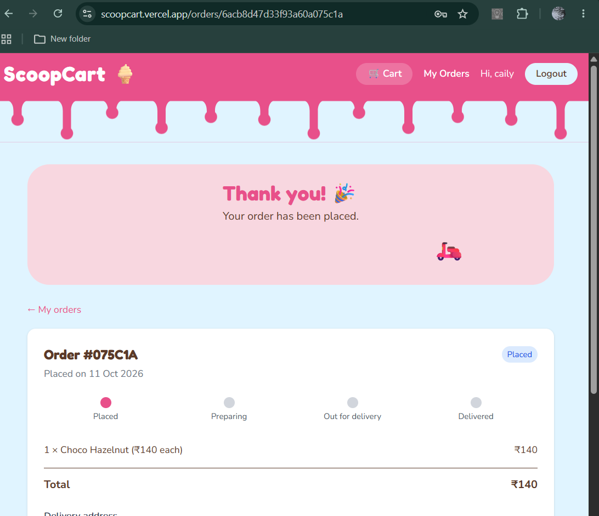
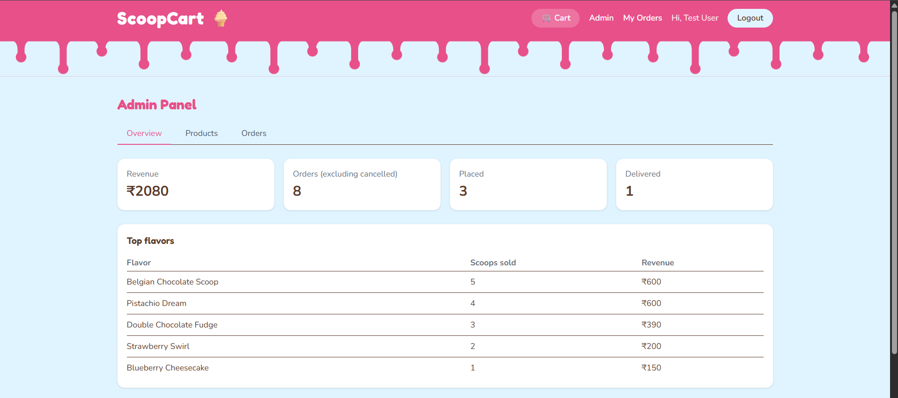
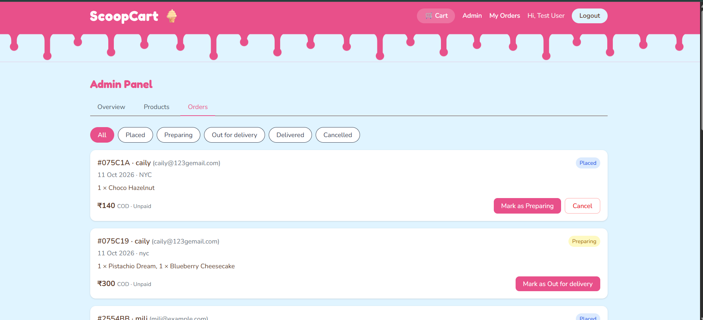

# 🍦 ScoopCart

A full-stack online ice cream ordering platform built with the MERN stack. Customers browse flavors, build a cart and place orders. Admins manage flavors, track orders and view sales analytics.

**🔗 Live demo:** https://scoopcart.vercel.app
**⚠️ Note:** The backend runs on a free tier and may take up to a minute to wake up on the first visit.

## Features

**Customers**
- Register, login and logout with JWT stored in httpOnly cookies
- Browse flavors with search, category filter, sorting and pagination
- Product details page and a cart that persists across refreshes
- Checkout with address validation (Cash on Delivery)
- Order history, order tracking with a status progress bar, and order cancellation

**Admins**
- Role-based access control (user / admin)
- Dashboard with revenue, order counts and top-selling flavors
- Create, edit and delete flavors, and control availability and stock
- View all orders, filter by status and move them through the delivery flow

## Tech stack

| Layer | Technology |
|---|---|
| Frontend | React (Vite), React Router, Context API, Axios, Tailwind CSS |
| Backend | Node.js, Express |
| Database | MongoDB Atlas, Mongoose |
| Auth | JWT in httpOnly cookies, bcrypt |
| Security | Helmet, rate limiting, input whitelisting |
| Deployment | Vercel (frontend), Render (API), MongoDB Atlas |

## Architecture

    Browser → Vercel (React app, proxies /api/*) → Render (Express API) → MongoDB Atlas

Vercel forwards `/api` requests to the backend, so the browser sees a single origin. This keeps the httpOnly auth cookie first-party and avoids third-party cookie blocking.

## Screenshots

| | |
|---|---|
|  |  |
|  |  |
|  |  |

## Key engineering decisions

- **Server-side pricing:** the client sends only product IDs and quantities. The server reads real prices from the database and calculates the total, so prices cannot be tampered with.
- **Overselling protection:** stock is checked and reduced in one atomic `findOneAndUpdate`. If any item fails, stock already reserved is restored. Cancelling an order returns the stock.
- **Price snapshot:** order items store the name and price at purchase time, so order history stays correct if prices change later.
- **Security:** httpOnly cookies, bcrypt password hashing, passwords excluded from queries by default, field whitelisting on writes (prevents mass assignment), escaped search input, Helmet headers and rate limiting on auth routes.
- **Analytics with aggregation:** admin revenue and top-flavor stats use MongoDB aggregation pipelines.

## API reference

| Method | Endpoint | Access | Description |
|---|---|---|---|
| POST | `/api/auth/register` | Public | Create an account |
| POST | `/api/auth/login` | Public | Log in |
| POST | `/api/auth/logout` | Public | Log out |
| GET | `/api/auth/me` | User | Current user |
| GET | `/api/products` | Public | List flavors (`search`, `category`, `sort`, `page`, `limit`) |
| GET | `/api/products/:id` | Public | Flavor details |
| POST | `/api/products` | Admin | Create flavor |
| PUT | `/api/products/:id` | Admin | Update flavor |
| DELETE | `/api/products/:id` | Admin | Delete flavor |
| POST | `/api/orders` | User | Place an order |
| GET | `/api/orders/myorders` | User | My orders |
| GET | `/api/orders/:id` | Owner/Admin | Order details |
| PUT | `/api/orders/:id/cancel` | Owner/Admin | Cancel a placed order |
| GET | `/api/orders` | Admin | All orders (`status` filter) |
| PUT | `/api/orders/:id/status` | Admin | Advance order status |
| GET | `/api/orders/stats` | Admin | Revenue and top flavors |

## Project structure

    scoopcart/
    ├── client/              # React app
    │   └── src/
    │       ├── api/         # Axios instance
    │       ├── components/  # Navbar, ProductCard, DripBorder, ProtectedRoute...
    │       ├── context/     # AuthContext, CartContext
    │       └── pages/       # Home, Cart, Checkout, Orders, Admin...
    └── server/              # Express API
        ├── config/          # Database connection
        ├── controllers/     # Business logic
        ├── middleware/      # Auth and error handling
        ├── models/          # Mongoose schemas
        ├── routes/          # Route definitions
        └── utils/           # Helpers

## Run locally

Requires Node.js 20+ and a MongoDB Atlas connection string.

    git clone https://github.com/prakrutiii/scoopcart.git
    cd scoopcart/server
    npm install
    cp .env.example .env        # on Windows: copy .env.example .env
    npm run seed                # adds sample flavors
    npm run dev

In a second terminal:

    cd scoopcart/client
    npm install
    npm run dev

Open http://localhost:5173. To try admin features, set a user's `role` to `admin` in the database.

### Environment variables (`server/.env`)

| Variable | Description |
|---|---|
| `PORT` | API port (default 5000) |
| `MONGO_URI` | MongoDB connection string |
| `JWT_SECRET` | Long random secret for signing tokens |
| `CLIENT_URL` | Frontend URL (default `http://localhost:5173`) |
| `NODE_ENV` | `production` in deployment |

## Roadmap

- Online payments with Razorpay
- Product reviews and ratings (data model already in place)
- Image uploads for flavors
- Automated API tests in CI

## Author

**Prakruti Donga** — [LinkedIn](https://linkedin.com/in/prakruti-donga-a4193228a) · [GitHub](https://github.com/prakrutiii)